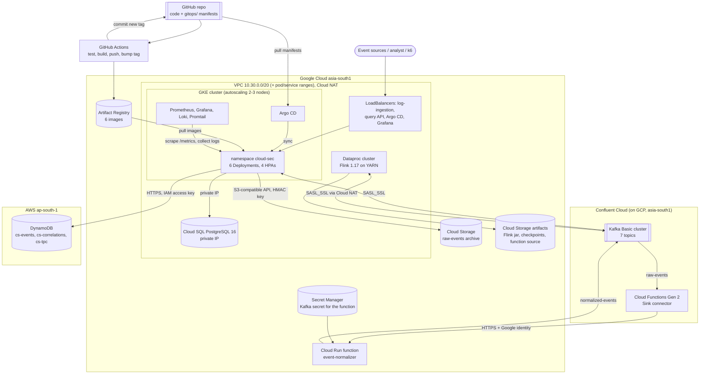
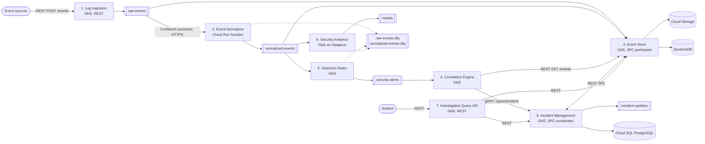
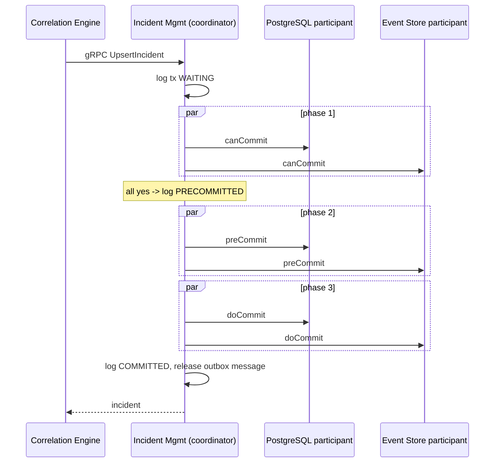

# Design Document: Cloud Security Monitoring

CS G527 Cloud Computing, scenario S25: *Cloud Security Monitoring, correlating events across simulated cloud services*. Scenario concept: **three-phase commit (3PC)**.

This is the group design document. The detailed design of the three core services and of 3PC is in [core-services.md](core-services.md); this document covers the whole system and refers to it where the detail lives. Deployment steps are in [../DEPLOYMENT.md](../DEPLOYMENT.md).

## 1. System overview

The system ingests security and audit events from simulated cloud services, normalizes them, detects suspicious patterns, correlates detections into incidents, and lets an analyst investigate. A streaming job summarizes activity in time windows.

One event travels through the system like this:

1. A source posts an event (for example an SSH failed-login line or a CloudTrail-style record) to the public **Log Ingestion** REST API, which validates it and publishes it to Kafka topic `raw-events`.
2. The **Event Normalizer**, a Cloud Run function triggered by that topic through a managed Confluent connector, turns it into the common schema and publishes it to `normalized-events`. Invalid events go to a dead-letter topic.
3. **Detection Rules** evaluates normalized events against rules (currently: five failed logins from one IP in 60 seconds) and publishes alerts to `security-alerts`.
4. The **Correlation Engine** groups alerts for the same entity into a candidate incident, enriches it from the Event Store over REST, and sends it to Incident Management over gRPC.
5. **Incident Management** creates or updates the incident. It writes the incident to PostgreSQL and the correlation history to the Event Store **atomically, using 3PC**, then publishes the change to `incident-updates`.
6. The **Event Store** archives every raw event to Cloud Storage and stores every normalized event in DynamoDB, so the evidence behind an incident can be retrieved.
7. An analyst uses the public **Investigation Query API** to list incidents and open one with its history and the events behind it.
8. In parallel, **Security Analytics** (Flink) reads `normalized-events` and publishes per-minute and per-five-minute aggregates to the `results` topic.

### Requirement coverage

| Req. | What the assignment asks | How it is met |
|---|---|---|
| a | All infrastructure through IaC | Terraform in `infra/terraform`, across Google Cloud (VPC, GKE, Artifact Registry, Dataproc, Cloud Run function, Cloud SQL, Cloud Storage, IAM), Confluent Cloud (cluster, topics, keys, connector) and AWS (DynamoDB, IAM), plus the Helm releases for Argo CD and observability |
| b | One serverless, event-driven service; REST, gRPC and a message queue all in use | Event Normalizer is a Cloud Run function invoked asynchronously for each batch on `raw-events`. REST: ingestion, Event Store, query API. gRPC: Correlation Engine to Incident Management. Queue: Kafka (Confluent Cloud), seven topics |
| c | Managed Kubernetes, HPAs on at least two services, load test | GKE. HPAs on Log Ingestion, Detection Rules, Correlation Engine, Event Store. k6 test in `loadtest/` |
| d | GitOps controller, no direct `kubectl apply` | Argo CD app-of-apps tracking `gitops/` on `main`; CI changes a deployment only by committing a new image tag |
| e | Flink on a managed cluster, Kafka in, stateful windowed aggregation, results to Kafka | Security Analytics on Dataproc; tumbling event-time windows; output topic `results` |
| f | Scenario concept (3PC) applied to the domain | Incident creation commits across PostgreSQL and DynamoDB with 3PC (section 6) |
| g | Three distinct storage products | Cloud Storage (raw archive), DynamoDB (events, correlation history, 3PC log), Cloud SQL PostgreSQL (incidents) |
| h | Prometheus, Grafana, centralized logging | kube-prometheus-stack, one Grafana dashboard, Loki with Promtail |

## 2. Cloud deployment architecture

The system spans three providers, each chosen for what it does best here (section 9 explains why):

- **Google Cloud** (`asia-south1`) runs almost everything: GKE, Dataproc, the Cloud Run function, Cloud SQL, Cloud Storage and Artifact Registry, inside one VPC.
- **Confluent Cloud** runs Kafka on a Basic cluster hosted on Google Cloud in the same region, plus the managed connector that triggers the function.
- **AWS** (`ap-south-1`) holds only the Event Store's DynamoDB tables.

| Layer | Product | Notes |
|---|---|---|
| Network | VPC with secondary ranges for pods and services, firewall for internal traffic, Cloud NAT, private services access | NAT gives Dataproc's internal-only nodes a way out to Confluent Cloud |
| Stateless services | GKE, zonal cluster, one autoscaling node pool (`e2-standard-4`, 2 to 3 nodes; the free-trial quota of 24 vCPUs is shared with Dataproc) | GKE's built-in metrics server feeds the HPAs; the cluster autoscaler adds nodes when HPAs need room |
| Serverless | Cloud Run function (2nd gen, Node 22), entry point `normalize` | Invoked by Confluent's managed connector with batches of up to 50 records; IAM-protected |
| Stream processing | Dataproc 2.2 with the Flink optional component (Flink 1.17, Java 11) | Job submitted with `gcloud dataproc jobs submit flink`; checkpoints in Cloud Storage; Flink UI through Component Gateway |
| Messaging | Confluent Cloud Basic cluster on GCP | SASL PLAIN over TLS; topics created by Terraform with three partitions each |
| Storage | Cloud Storage, Cloud SQL PostgreSQL 16, DynamoDB | Section 5 |
| Images | Artifact Registry (Docker) | CI writes with a service account limited to `artifactregistry.writer` |
| Identity | Google service accounts per component (GKE nodes, function, connector invoker, Dataproc, Cloud Storage writer, CI); one AWS IAM user for DynamoDB | Each identity holds only the permissions its component needs |

Terraform (`infra/terraform`) uses three providers in one configuration. Rishit's original data module now lives on as `modules/core-data` and holds only the DynamoDB tables and their IAM policy. Terraform writes into the cluster what the services read: a ConfigMap `infra-endpoints` (Kafka bootstrap, bucket, database IP, in-cluster URLs) and three Secrets (`kafka-credentials`, `incident-db`, `event-store-cloud`).

## 3. Microservices architecture

### Service responsibilities

| # | Service | Responsibility | Runtime | Scaling |
|---|---|---|---|---|
| 1 | Log Ingestion | Public entry point. Validates an event, adds an ID and receive time, publishes to `raw-events`. Returns 202 once Kafka has acknowledged. | Node 22, Fastify, GKE, port 3000 | HPA 2 to 8, CPU 50% |
| 2 | Event Normalizer | Converts raw events to the common schema (category, action, outcome, actor, network, entity key). Routes invalid events to the DLQ. Same handler code as the earlier Lambda version; `src/gcf.js` adapts the HTTP request. | Cloud Run function (2nd gen), Node 22 | Cloud Run instances, up to 10 |
| 3 | Correlation Engine | Groups alerts per entity inside a 15-minute window, escalates severity after three alerts, enriches from the Event Store, upserts the incident. | Node 22, GKE, port 8083 | HPA 1 to 3, CPU 70% |
| 4 | Event Store | Archives raw events to Cloud Storage, stores normalized events and correlation history in DynamoDB, serves them over REST. 3PC participant. | Node 22, GKE, port 8081 | HPA 1 to 3, CPU 70% |
| 5 | Detection Rules | Evaluates normalized events against rules and emits alerts. One rule today: repeated failed logins from one IP. | Node 22, GKE, no HTTP | HPA 1 to 3, CPU 60% |
| 6 | Incident Management | Owns incidents. 3PC coordinator. Publishes every change through a transactional outbox. Serves analyst status changes. | Node 22, GKE, REST 8082 and gRPC 50051 | Exactly one pod, `Recreate` |
| 7 | Investigation Query API | Read-only API for analysts. Returns an incident together with its history, its correlation history and the events in its window, from one call. Short-lived response cache. | Node 22, GKE, port 8084 | 2 replicas |
| 8 | Security Analytics | Windowed aggregates over normalized events: events per category (60 s), events per source IP (60 s), authentication activity per source IP (300 s), with distinct users and targets. | Flink 1.17 on Dataproc | Flink parallelism 3 |

## 4. Interconnection mechanisms

| Mechanism | Where | Why this one |
|---|---|---|
| **REST** | Sources to Log Ingestion; analyst to Query API; Query API and Correlation Engine to Event Store; Query API to Incident Management; 3PC messages between Incident Management and Event Store | Simple request and reply, easy to call from outside the cluster and to load test. 3PC phases are idempotent calls keyed by transaction ID, which fits HTTP |
| **gRPC** | Correlation Engine to Incident Management (`incident.v1.IncidentService/UpsertIncident`) | An internal, typed command with a deadline. The proto file is the contract between two services, and gRPC status codes (`UNAVAILABLE` when the coordinator is busy) drive the caller's retry |
| **Kafka** (Confluent Cloud) | Every hop in the event pipeline; the hop into the function goes through Confluent's managed Cloud Functions sink connector, which calls it over HTTPS | The pipeline is asynchronous and bursty. Kafka decouples producers from consumers, lets several consumers read the same topic (Event Store, Detection Rules and Flink all read `normalized-events`), and keeps ordering per entity through the message key |

Topics: `raw-events`, `normalized-events`, `security-alerts`, `incident-updates`, `results`, and two dead-letter topics, created by Terraform with three partitions each. Every client authenticates with SASL PLAIN over TLS. Producers are idempotent and wait for all in-sync replicas.

Delivery is at-least-once everywhere, so every consumer is written to tolerate duplicates: the Event Store writes by event ID, Flink deduplicates by event ID before windowing, Incident Management deduplicates alerts, and 3PC calls can be repeated safely.

## 5. Storage (requirement g)

| Product | Holds | Why |
|---|---|---|
| **Cloud Storage** | Every raw event as `raw/YYYY/MM/DD/HH/<eventId>.json`; separately, the Flink jar, Flink checkpoints and the function source | Cheap, durable, write-once archive. Raw events are evidence and are rarely read. Objects expire after 30 days. The Event Store writes through Cloud Storage's S3-compatible XML API with an HMAC key, so its archive code is unchanged |
| **DynamoDB** | `cs-events` (normalized events, keyed by entity and time, with an index by event ID), `cs-correlations` (one item per incident version), `cs-tpc` (the participant's 3PC log) | High write rate, simple key lookups and range queries by entity and time, no schema migrations. Conditional writes give the 3PC participant safe state changes across replicas |
| **Cloud SQL PostgreSQL 16** | Incidents, their history, alerts, the 3PC coordinator log, the outbox | Incidents are relational and need transactions, uniqueness constraints and optimistic locking by version. The outbox must commit in the same transaction as the incident change |

## 6. The scenario concept: three-phase commit (requirement f)

**Where it applies.** A correlation decision changes two stores owned by two services: the incident row in PostgreSQL (Incident Management) and the correlation history in DynamoDB (Event Store). If only one were written, an analyst would see an incident with no evidence trail, or a trail for an incident that does not exist. The two writes therefore commit atomically.

**How it works.** Incident Management is the coordinator; its own PostgreSQL store and the Event Store are the two participants.

- Any "no" vote or timeout in phase 1 aborts the transaction on both sides.
- Once every participant has acknowledged `preCommit`, the decision is commit. A participant that then loses the coordinator commits on its own after a timeout, after first asking the coordinator for its decision if it can be reached. This is what makes 3PC non-blocking where 2PC would leave the participant stuck holding locks.
- The coordinator logs every transaction before asking for votes and runs recovery at startup and every 15 seconds, finishing or aborting whatever was in flight.
- Because there must be only one coordinator, Incident Management runs as exactly one pod with the `Recreate` strategy and no HPA.

The states, timeouts, recovery rules, the cases in which the guarantee can break (a network partition combined with timeouts), and the comparison with 2PC are in [core-services.md, "Three-phase commit"](core-services.md#three-phase-commit-requirement-f).

**Demo.** `scripts/demo-3pc.sh` runs three scenarios on Docker Compose: a normal commit, a participant voting no, and a coordinator crash after pre-commit followed by the participant committing on its own and the coordinator recovering. Fault injection is deliberately not available through GitOps.

## 7. Kubernetes, GitOps and CI (requirements c, d)

- **Manifests.** `gitops/services/<name>/` holds a Deployment, Service, ServiceMonitor and, where it applies, an HPA, assembled with Kustomize. `gitops/argocd/` holds one Argo CD `Application` per service plus one for the Grafana dashboard.
- **App of apps.** Terraform installs Argo CD and a single root Application that tracks `gitops/argocd` on `main`. Everything else is discovered from Git. Sync is automatic with pruning and self-healing, so a manual change in the cluster is reverted.
- **Delivery.** GitHub Actions runs the tests, builds the six images, pushes them to Artifact Registry tagged with the commit SHA, and commits that tag into each `kustomization.yaml`. Argo CD notices the commit and rolls out. CI's service account can only write images; it has no cluster credentials.
- **Autoscaling.** HPAs use CPU (and memory at 80%) against container requests of 100 m CPU and 128 Mi. Scale-up is immediate, scale-down waits two minutes. When pods do not fit, the GKE cluster autoscaler adds nodes (up to three). Detection Rules, Correlation Engine and Event Store are capped at three replicas because their topics have three partitions, so more consumers would sit idle.
- **Load test.** `loadtest/ingest-load.js` (k6) uses an open arrival-rate model: 20 requests per second, ramp to 300, hold five minutes, then drop. Events are realistic and reuse a small pool of source IPs so the detection rule fires. Thresholds: under 2% errors, p95 under 800 ms.

## 8. Observability (requirement h)

- **Metrics.** Every HTTP service exposes `/metrics` with the same metric names (`http_requests_total` by route, method and status; `http_request_duration_seconds` histogram), plus service-specific ones (3PC transactions, Kafka consumption, outbox held rows). ServiceMonitors make Prometheus scrape them. Kafka throughput and consumer lag are visible in the Confluent Cloud console.
- **Dashboard.** One Grafana dashboard, loaded from a ConfigMap in Git: request rate, 5xx rate, p50/p95/p99 latency per service, HPA current and desired replicas, pod CPU and memory, nodes ready, pods not running, container restarts, and a live log panel.
- **Logs.** All services log JSON to stdout. Promtail runs on every node and ships pod logs to Loki; Grafana queries Loki. The function's logs go to Cloud Logging, and the Flink job's logs are in the Dataproc job page and YARN logs.

## 9. Design choices and rationale

| Choice | Reason | Trade-off accepted |
|---|---|---|
| Google Cloud for compute | Most of the team's credits are on Google Cloud; GKE, Dataproc, Cloud Run functions and Cloud SQL cover every requirement | Three providers to configure instead of one |
| Kafka on Confluent Cloud | A fully managed Kafka with a managed connector that can invoke a Google function, and its own free credits | Clients now need credentials (SASL), and traffic leaves the VPC over TLS |
| DynamoDB stays on AWS | The Event Store's 3PC participant is built on DynamoDB conditional writes and was frozen after three review rounds; porting it to Firestore was the riskiest change possible. DynamoDB on-demand costs cents | A cross-cloud call for each event write, and an AWS access key in the cluster instead of a workload identity |
| Cloud Storage through its S3-compatible API | The Event Store's archive code did not have to change; only an endpoint, a region and an HMAC key are configured | Newer S3 checksum headers had to be switched off for compatibility |
| Function triggered through the Confluent connector | Keeps the normalizer event-driven and serverless without running a consumer; Confluent retries failed batches | The connector sends record values only, so the function synthesises the Kafka origin of each event |
| Flink on Dataproc rather than on GKE | The assignment asks for a managed cluster; Dataproc supplies YARN, the Flink runtime, Component Gateway and job management | The job had to target Flink 1.17 and Java 11, the versions Dataproc ships |
| 3PC with a single coordinator pod | Removes coordinator races entirely; recovery on restart is enough for availability at this scale | Incident creation pauses while the pod restarts (alerts wait in Kafka and are retried) |
| Event Store as its own service in front of S3 and DynamoDB | One owner for event data and one place for the 3PC participant logic | An extra network hop for reads |
| Separate read API (Investigation Query API) | Analysts get one endpoint and one response shape; write services are not exposed publicly; reads can be cached and scaled on their own | It depends on two upstream services; a failed enrichment returns partial data instead of an error |
| Kustomize and plain manifests rather than a Helm chart per service | Small, readable, and the image tag is a one-line change CI can commit | Some repetition across services |
| Terraform creates the database Secret | No extra operator to install | The password is present in Terraform state; External Secrets Operator is the production answer |
| Zonal GKE, zonal Cloud SQL, one Dataproc master, small machines | Cost of a course project | Not highly available |

## 10. Verification

Tested on 17 November 2026, after the move to Google Cloud and Confluent Cloud:

| Check | Result |
|---|---|
| Unit tests, Node 22 on Linux (the CI and image runtime) | All pass: common 10, tpc 77, event-store 72, incident-management 25 (35 integration tests skipped without the Compose stack), correlation-engine 33, query API 6, detection-rules 5, event-normalizer 29 (7 new for the Cloud Run entry point) |
| Flink job: `mvn package` with its unit tests, compiled for Java 11 against Flink 1.17.2 | Passes; produces the shaded `security-analytics-1.0.0.jar` (Flink itself is `provided` by Dataproc) |
| `terraform validate` (Terraform 1.9; google 6.50, confluent 2.95, aws 5.100 providers) | Valid |
| Kustomize build of all six services | Renders |
| Docker build of all six images | Builds |
| Full pipeline on Docker Compose (`scripts/e2e-local.sh`) | Six failed logins in; an incident with history, correlation history and six events returned by the query API about six seconds later |
| Cloud Run entry point under the Functions Framework, fed a JSON array as the connector sends it | One valid event reached `normalized-events`, one invalid event reached `raw-events-dlq` |
| k6 smoke profile against the local stack | 550 requests, 0% errors, p95 57 ms |

Not yet verified: nothing has been applied to Google Cloud, Confluent Cloud or AWS. The GKE rollout, the Confluent connector invoking the function, the Flink job on Dataproc reading from Confluent, the cross-cloud DynamoDB and Cloud Storage calls, HPA scale-out under the full load test and the Grafana dashboard have not been observed running. One `@core/tpc` test fails on Node 24 under Windows and passes on Node 22 under Linux.

## 11. Known limits

- The two public APIs have no authentication.
- Secrets (Kafka API key, database password, AWS access key, HMAC key) pass through Terraform state, and the Kafka key is visible in the Dataproc cluster properties.
- The function cannot see the real Kafka partition and offset of a record; its `origin` is synthetic.
- Cloud SQL is reached over its private IP without TLS (the traffic never leaves the VPC).
- Detection has a single rule, and suppresses repeat alerts for the same entity for 60 seconds.
- Flink checkpointing is at-least-once, so a restart can re-emit a window result; consumers should deduplicate on `resultId`.
- Nothing consumes `results` or `incident-updates` yet; they are available for a dashboard or notifier.
- 3PC can still split under a network partition combined with timeouts; the cases and the manual resolution are documented in [core-services.md](core-services.md#known-limits).
