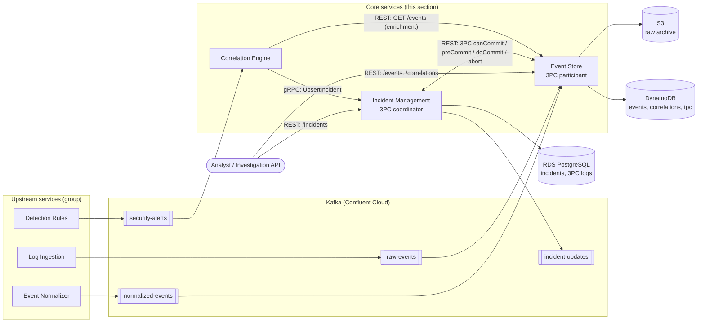
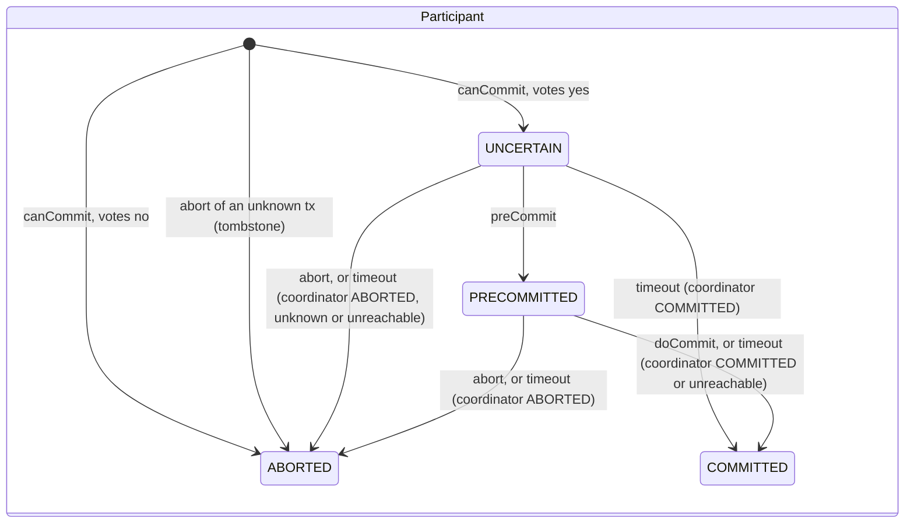
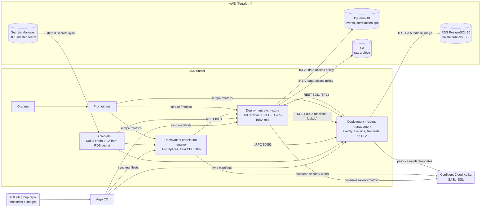

# Core services: Correlation Engine, Incident Management, Event Store

Section for the group design document (scenario S25, Cloud Security Monitoring). Owner: Rishit.
Requirements covered here: **f** (the scenario concept, three-phase commit) and **g** (three distinct storage products).

## Responsibilities

| Service | Responsibility | Interfaces | Storage |
|---|---|---|---|
| **Correlation Engine** | Consumes `security-alerts` and groups related alerts for the same entity (`entityKey`) inside a correlation window into a candidate incident, escalating severity. Enriches each candidate from the Event Store, then hands it to Incident Management. | Kafka in, REST out (Event Store), gRPC out (Incident Management); `/health`, `/ready`, `/metrics` on 8083 | none (in-memory windows) |
| **Incident Management** | Creates and updates incidents. It is the **3PC coordinator**: each correlation decision commits atomically across its own Postgres participant and the Event Store participant. Publishes every change to `incident-updates`. Serves analysts (list, get, status changes). | gRPC in (50051), REST in (8082), REST out (Event Store 3PC routes), Kafka out | **PostgreSQL (RDS)** |
| **Event Store** | Keeps every raw and normalized event and the history of correlation decisions. Serves events by ID and by entity and time range. **3PC participant** for correlation-history writes. | Kafka in, REST in (8081) | **S3** (raw archive), **DynamoDB** (events, correlation history, 3PC records) |

## Architecture

### Processing an alert

1. Detection Rules publishes an alert keyed by `entityKey`, so every alert for one entity lands on one partition and is handled in order by one Correlation Engine replica.
2. The Correlation Engine adds the alert to the entity's open group, or opens a new group when the alert is more than the window (15 min) after the group's last alert. It ignores an `alertId` it has already seen (alerts can be redelivered). The group's `correlationId` is `cor-` + the first 24 hex characters of `sha256(entityKey|firstAlertId)`. Severity is the maximum of the alerts, raised to `critical` at 3 alerts or 2 distinct rules.
3. It asks the Event Store for the entity's stored events in the group's window (event count, distinct users, failures). If the Event Store is slow or down, it continues with `enrichment: null` instead of blocking the pipeline.
4. It calls `UpsertIncident` over gRPC. Incident Management finds the incident by `correlationId` (or, after a Correlation Engine rebalance, an open incident for the same entity inside the window) and merges the candidate:
   - **create:** a new incident at version 1
   - **update:** union of alerts and rules, maximum severity, version + 1. Status is never touched.
   - **noop:** every alert is already known, so no transaction runs.
5. A create or update runs as one 3PC transaction (below). The Postgres side of the commit also writes the `incident.created` or `incident.updated` message into a transactional **outbox** table in the same transaction. A relay publishes outbox rows to `incident-updates` in order every second, so a committed change is never lost by a crash or a Kafka outage (delivery is at-least-once; consumers dedupe on `incidentId` + `version` + `type`).
6. If the upsert fails (abort, timeout, Incident Management down), the Correlation Engine forgets the alert and rethrows, so Kafka redelivers it and the retry re-sends it. A redelivered alert that already committed is a noop.

## Interconnections and why each fits

| Link | Mechanism | Why |
|---|---|---|
| Upstream → Event Store, Correlation Engine | **Kafka** topics | Decouples producers from consumers, absorbs bursts, allows replay (`fromBeginning`), and partitions by entity so per-entity ordering is preserved. |
| Correlation Engine → Incident Management | **gRPC** (`incident.v1.IncidentService`) | Internal, synchronous, typed request/response with a strict contract (protobuf) and deadlines. The caller needs the outcome (`created`/`updated`/`noop`) and a precise status code (`ABORTED` → retry, `INVALID_ARGUMENT` → skip). |
| Correlation Engine → Event Store (enrichment), analysts → both | **REST** | Simple resource reads (`/events`, `/correlations`, `/incidents`) usable from any client, browser or the Investigation Query API. |
| Incident Management ↔ Event Store (3PC) | **REST** (`/tpc/:txId/...`) | Each 3PC message is an idempotent, short request; HTTP status codes carry the participant state (409 `bad_state` with the current state). |
| Incident Management → others | **Kafka** `incident-updates` | Fan-out of incident changes to any future consumer (notifications, dashboards) without coupling. |

Together with the group's other services this satisfies requirement b's "REST, gRPC and message queues, each at least once".

## Storage: three products (requirement g)

| Product | Used for | Why this product |
|---|---|---|
| **Amazon S3** (object storage) | Raw events as JSON objects under `raw/yyyy/mm/dd/hh/<eventId>.json`; expired after 30 days | Cheap, durable archive for immutable blobs that are rarely read. A lifecycle rule handles retention. |
| **Amazon DynamoDB** (managed NoSQL) | `events` (PK `entityKey`, SK `eventTime#eventId`, GSI on `eventId`), `correlations` (PK `correlationId`, SK `version`), `tpc` (3PC participant records) | High write rate with no schema migrations. The key design serves the two read patterns directly: by entity and time range, and by `eventId`. Conditional writes make redelivery idempotent. |
| **Amazon RDS for PostgreSQL** (managed SQL) | Incidents, their alerts and history, the 3PC coordinator log and the local participant records | Incidents are relational and updated in place under constraints (unique `correlation_id`, status and severity checks, optimistic `version`). Analysts filter and sort them. A local ACID transaction makes each participant step atomic. |

All three are created by Terraform (`infra/terraform/`, requirement a). Locally they are emulated by an S3 mock, DynamoDB Local and Postgres in Docker Compose.

## Three-phase commit (requirement f)

**What is atomic:** each correlation decision (incident create or update) is written to two independent stores: the incident in Postgres (Incident Management) and the correlation-history version in DynamoDB (Event Store). 3PC guarantees that both or neither record the decision. Analyst status changes are plain local Postgres updates and are not part of 3PC.

**Participants:** `incident-db` (in-process, records in the Postgres table `tpc_participant`) and `event-store` (over REST, records in the DynamoDB table `tpc`). The shared state machines live in `packages/tpc`, a pure package (no I/O) used by both services.

### States

Coordinator log (Postgres `tpc_coordinator`): `WAITING` → `PRECOMMITTED` → `COMMITTED`, or `ABORTED` from either of the first two.

Timeout guards (in parentheses above): on a timeout a participant first asks the coordinator. It waits while the answer is `PENDING`, and a `PRECOMMITTED` record the coordinator has no entry for is kept for an operator rather than committed. The `abort` of an unknown transaction leaves an `ABORTED` tombstone, so a late `canCommit` for it votes no.

### Protocol

1. **canCommit:** the coordinator logs `WAITING` and asks every participant to vote, each raced against a 3 s timeout. The `incident-db` participant validates and records its vote in one Postgres transaction under a per-incident advisory lock, which analyst `PATCH`es also take, so nothing can change the incident between "validated" and "voted yes". A participant votes yes only if the decision still applies cleanly:
   - The Event Store checks the payload.
   - `incident-db` checks that no other transaction is in flight for the same `correlationId`, and that the incident is absent (create) or still at `version - 1` (update).
   A "no" vote, an error or a timeout makes the coordinator log `ABORTED` and send `abort` to everyone.
2. **preCommit:** the coordinator logs `PRECOMMITTED` and sends `preCommit`. Any failure or timeout aborts everyone.
3. **doCommit:** once every participant has acknowledged `preCommit`, the decision is final. The coordinator sends `doCommit` (retried up to 5 times with backoff) and logs `COMMITTED` only when every participant acknowledged; otherwise the log stays `PRECOMMITTED` and recovery finishes it. Each participant's commit is **atomic with its state change**: the business write and the transition to `COMMITTED` happen together (one DynamoDB `TransactWriteItems`, one Postgres transaction), so there is never a business write without `COMMITTED` or the reverse. The **effects are idempotent** rather than "applied exactly once": after a crash the commit can run again, and the second run changes nothing (a DynamoDB conditional put, and a history row keyed by `tx_id` in Postgres).

Participant state changes are **conditional writes** in both stores (DynamoDB condition expression, Postgres `UPDATE … WHERE state = expected`). Several Event Store replicas can therefore serve the same transaction: if one replica's timeout sweep and another's `preCommit` race, exactly one write wins and the loser re-reads and re-evaluates.

The coordinator serialises `run()` and recovery **per transaction** and, inside that lock, recovery re-reads the transaction's current log state, so it never acts on a stale snapshot: it skips finished transactions, and a stale `WAITING` snapshot can no longer turn into an `ABORTED` over a transaction that has since reached `PRECOMMITTED`. Recovery still writes `ABORTED` over a `PRECOMMITTED` entry when replaying `preCommit` finds a participant that already aborted (it timed out in `UNCERTAIN` before receiving `preCommit`); that is the correct 3PC outcome, the same as `run()`'s `precommit_failed`.

### Timeouts and recovery

- **Participant timeouts** (Event Store 10 s, `incident-db` 10 s, checked every 2 s). Before acting on a timeout, a participant first **asks the coordinator for its decision** (`GET /tpc/transactions/:txId` on Incident Management; the in-process `incident-db` participant reads the coordinator log directly):
  - `COMMITTED` or `ABORTED`: it follows that decision (an `UNCERTAIN` participant told `COMMITTED` commits).
  - `WAITING` or `PRECOMMITTED`, or an answer it can't interpret (5xx, malformed body, unknown state): the coordinator is alive, so it waits and asks again on the next sweep.
  - **Unknown transaction** (404): the coordinator logs `WAITING` before any `canCommit`, so it never started this transaction. An `UNCERTAIN` participant aborts; a `PRECOMMITTED` one is kept and logged at error level (impossible with an intact log; an operator has to resolve it).
  - **Coordinator unreachable** (connection refused, DNS failure, lookup timeout): the classic 3PC timeout rule. An `UNCERTAIN` participant aborts on its own; a `PRECOMMITTED` participant commits on its own. This is safe under crash failures because the coordinator only sends `preCommit` after everyone voted yes.
- **Coordinator recovery** (`recover()` at start-up before the service reports ready, then **every 15 s**; it never touches a transaction `run()` is still driving):
  - A `WAITING` transaction is aborted everywhere.
  - A `PRECOMMITTED` transaction is replayed: `preCommit` is re-sent to all participants.
    - If a participant already **committed** on its timeout, that counts as an acknowledgement.
    - If one already **aborted**, recovery aborts everyone.
    - If one is unreachable, the transaction stays `PRECOMMITTED` and the next pass retries.
    - Otherwise recovery sends `doCommit` to all and logs `COMMITTED`.
- **Fault injection for the demo:** `TPC_FORCE_VOTE=no` on the Event Store, and `TPC_FAULT=crash-after-precommit` on Incident Management. The latter exits the process after all `preCommit` acknowledgements. `scripts/demo-3pc.sh` shows all three outcomes; its recorded output is in `docs/handoff.md`.

- **Deadlines (no unbounded waits):** every participant call is raced against `TPC_TIMEOUT_MS` (3 s); `doCommit` and `abort` are retried up to 5 times, a timeout counting as a failed attempt. A `run()` waits at most `2 × TPC_TIMEOUT_MS × 5` (30 s) for its transaction's lock and otherwise fails with `CoordinatorBusy` without writing anything (the gRPC caller gets `UNAVAILABLE` and retries). Recovery bounds each transaction the same way and moves on. A lock is never released while the work it guards can still change state; a participant call that times out and lands late is harmless, because the decision is logged before it is sent and participants only make conditional, idempotent writes.
- **Sweeps keep going:** a participant record whose commit fails (for example an Event Store history conflict) is left as it is, logged at error level and reported as pending, and the sweep carries on with the other records.

### When the atomicity guarantee holds

Both stores record the same decision whenever failures are **clean crashes that are eventually detected**: a crashed process restarts, and a live process can tell a crashed peer from a slow one. That covers every scenario in the demo and the realistic failures here (pod restarts, rollouts, a store briefly down).

It can split in two cases, and these are properties of 3PC itself rather than bugs:

- **(a) Participant crash in the middle of `preCommit`.** A participant persists `PRECOMMITTED` and crashes before its acknowledgement arrives. The coordinator sees a failed `preCommit` and aborts the other participant. When the crashed participant restarts, its timeout rule would commit. **Mitigated here:** it first asks the coordinator, sees `ABORTED` and aborts. The split remains possible only if the coordinator is also unreachable at that moment.
- **(b) Network partition.** If participants are cut off from each other and the coordinator during `preCommit`, one side can time out in `PRECOMMITTED` and commit while the other times out in `UNCERTAIN` and aborts.

The textbook remedy is a **termination protocol**, in which participants that time out consult each other (and elect a new coordinator) before acting, or a **consensus-based commit** such as Paxos Commit, which tolerates partitions. The coordinator lookup above is the cheap first step of that idea; the full protocol is out of scope for this assignment.

### Why 3PC instead of 2PC

In 2PC, a participant that voted yes and then loses the coordinator is **blocked**. It cannot commit (another participant might have voted no) and cannot abort (the coordinator might have committed), so it holds its state until the coordinator returns.

3PC adds the `PRECOMMITTED` state. A participant only reaches it after **everyone** voted yes, so a `PRECOMMITTED` participant knows the outcome can only be commit and can finish on its own after a timeout. An `UNCERTAIN` participant knows nobody can have committed yet, so it can abort on its own. A coordinator **crash** therefore never blocks the participants: when it is unreachable they decide on their own. (A coordinator that is up but keeps answering `PENDING` does hold them; that is deliberate, because it will finish the transaction itself.) The demo's crash scenario shows this: the Event Store finishes its side even before Incident Management restarts.

### Known limits

- **Partitions and double failures:** see "When the atomicity guarantee holds" above.
- **Slow but alive coordinator:** a decision lookup that times out (2 s) is treated as "unreachable", so a coordinator that is alive but slow can still lead a `PRECOMMITTED` participant to commit on its own while the coordinator decides to abort (or an `UNCERTAIN` one to abort while it commits). This is the remaining 3PC limit here; removing it needs a termination protocol or a consensus-based commit.
- **Single coordinator:** Incident Management runs as exactly one replica (K8s `Recreate` strategy). Two coordinators would run recovery on the same transactions. A restart is safe, because recovery finishes in-flight transactions. The Event Store, by contrast, can run several replicas (conditional writes).
- **Status changes are not 3PC:** an analyst `PATCH` is a local update with optimistic locking. It is serialised with the 3PC vote by the per-incident advisory lock and refused (409 `transaction_pending`) while a correlation transaction for that incident is in flight, so it can never invalidate a decided commit.
- **In-memory correlation windows:** windows live in the Correlation Engine replica that owns the partition, and groups are evicted 2 windows after they close. After a rebalance or eviction, the new owner starts new groups. Incident Management merges them into the open incident for the same entity when the windows overlap, and an alert can belong to only one incident (unique `alert_id`), so a redelivered alert never creates a duplicate incident.
- **Escalation after a rebalance (P2-2, not implemented):** the engine sends aggregated `severity` and `eventCount` per group. When a rebalanced engine's new group merges into an existing incident, Incident Management takes the maximum severity and event count, but it cannot re-derive "≥ 3 alerts or ≥ 2 rules → critical" from the merged set, because per-alert severity and event counts aren't sent or stored. Fixing it needs a per-alert summary in the gRPC request and in `incident_alerts`.
- **Hung database calls:** a coordinator-log (Postgres) call that hangs keeps that one transaction's lock until it returns. Its callers are bounded (`CoordinatorBusy`, recovery skips it), but the call itself isn't: the Postgres pool sets no `statement_timeout`. Setting one would bound it.
- **History conflicts need an operator:** if another transaction already owns an Event Store history row for the same `(correlationId, version)`, the Event Store refuses to acknowledge `doCommit` and stays `PRECOMMITTED`; recovery keeps retrying and logging until someone resolves it (see `docs/handoff.md`).
- **Delivery semantics:** `incident-updates` is at-least-once (outbox relay); consumers dedupe on `incidentId` + `version` + `type`. Relay batches are serialised by an advisory lock, and a 3PC message (with every later message of the same incident) is held back until the coordinator logs the transaction `COMMITTED`, so consumers never see a change the Event Store hasn't committed and always see an incident's versions in order. If a held message's transaction ends `ABORTED` (only after a timeout split), the relay marks it `discarded`, logs it at error level and releases the incident's later messages; the coordinator's decision wins. A `PRECOMMITTED` one is never expired; `outbox_held_rows` shows messages held for over 5 minutes.

## Deployment (AWS, requirement c/d context)

Deployment is Ansh's integration work (EKS, Argo CD, observability); this is how these three services are meant to sit in it.

- **GitOps (d):** images are built by CI and the manifests live in the group repo; Argo CD syncs them, never `kubectl apply`.
- **Scaling (c):** correlation-engine and event-store are stateless and get CPU HPAs; incident-management is the single 3PC coordinator.
- **Secrets:** the RDS master password stays in Secrets Manager (created by RDS) and is synced into a K8s Secret, which feeds `PGUSER`/`PGPASSWORD`; Kafka credentials are another K8s Secret.
- **Observability (h):** every pod exposes `/metrics` and logs JSON to stdout; scraping, dashboards and log shipping are part of Ansh's integration.

## Observability (shared with requirement h)

Every service exposes `/health`, `/ready` and Prometheus `/metrics`, and logs pino JSON on stdout:

| Metric | Services |
|---|---|
| `http_requests_total{route,method,status}`, `http_request_duration_seconds` | all |
| `grpc_requests_total{method,code}`, `grpc_request_duration_seconds` | Incident Management |
| `tpc_transactions_total{outcome}` | Incident Management |
| `tpc_participant_messages_total{phase,result}`, `events_consumed_total{topic,result}` | Event Store |
| `alerts_consumed_total{result}`, `incidents_upserted_total{outcome}` | Correlation Engine |
